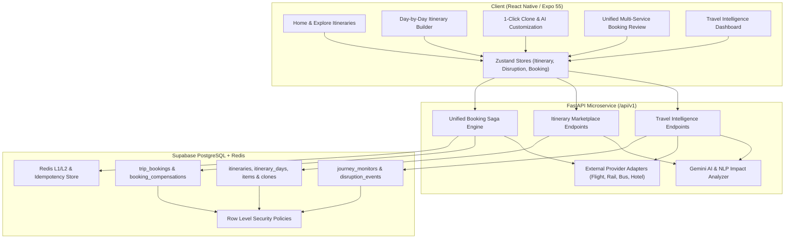

# Feature Implementation Plan: AI Travel Intelligence & One-Click Itinerary Cloning

**Platform**: Shopno Jatra (স্বপ্ন যাত্রা)  
**Status**: In Progress  
**Phases**: 8 Key Phases (Sequential execution)

---

## Architecture Blueprint

---

## Phase Breakdown

### Phase 1: Repository & Architecture Audit (COMPLETED)
- Inspected frontend (Expo 55, React Native 0.83, NativeWind, Zustand, Zod).
- Inspected backend (FastAPI, async SQLAlchemy, Pydantic v2, Redis, Celery).
- Inspected database (35+ Supabase migrations, existing tables: `bookings`, `flights`, `trains`, `hotels`, `trip_plans`).
- Generated `EXISTING_ARCHITECTURE_AUDIT.md`.

### Phase 2: Database Foundation
- Create migration `20260616_travel_intelligence_and_itinerary_marketplace.sql`:
  - **Travel Intelligence**: `journey_monitors`, `disruption_events`, `disruption_impacts`, `alternative_recommendations`, `alternative_searches`, `provider_status_logs`.
  - **Itinerary Marketplace**: `itineraries`, `itinerary_days`, `itinerary_items`, `itinerary_media`, `itinerary_tags`, `itinerary_saves`, `itinerary_clones`, `creator_profiles`, `creator_analytics`, `creator_attributions`.
  - **Booking Saga & Quotes**: `itinerary_customizations`, `itinerary_quotes`, `itinerary_quote_items`, `trip_bookings`, `service_bookings`, `booking_compensations`, `provider_reservations`.
  - **Security**: PostgreSQL RLS policies for public reading, creator editing, authenticated cloning, traveler data isolation, and admin/agency controls.
- Generate `DATABASE_CHANGELOG.md`.

### Phase 3: Itinerary Marketplace & Creator Studio
- **Backend**:
  - SQLAlchemy models in `backend/app/models/itinerary.py`.
  - Pydantic v2 schemas in `backend/app/schemas/itinerary.py`.
  - API router in `backend/app/api/v1/endpoints/itineraries.py`.
- **Frontend**:
  - TypeScript types in `src/types/itinerary.ts`.
  - Repository / Service in `src/services/itineraryService.ts`.
  - Creator Studio & Day-by-Day Builder UI matching the uploaded reference screens.
  - Explore Itineraries marketplace screen with category filters, search, budget ranges, and clone CTA.

### Phase 4: Itinerary Personalization & AI Budget Optimization
- **Backend & AI**:
  - Gemini AI itinerary customization and budget optimizer service (`backend/app/services/ai/itinerary_agent.py` and `src/services/ai/itineraryPersonalizer.ts`).
  - Structured output validation with Zod / Pydantic.
- **Frontend**:
  - Guided 1-Click Clone modal/screen (`app/screens/itinerary-clone.tsx`).
  - Real-time adjustment of dates, traveler counts, hotel category, budget slider, and pace.
  - Interactive comparison of original vs personalized itinerary.

### Phase 5: Booking Orchestration & Booking Saga
- **Provider Adapters**:
  - Flight adapter interface & implementations (Amadeus / Aviationstack / Mock provider).
  - Bangladesh Railway adapter (train live status, delay tracking, schedule validation).
  - Bus adapter (Inter-district Bangladesh bus operators: Green Line, Shohag, Hanif, Shyamoli).
  - Hotel adapter (check-in/check-out policies, room inventory).
- **Booking Saga**:
  - Unified booking orchestrator with idempotency, reservation holds, step-by-step confirmation, compensation cancellation on partial failure, and status tracking.
  - Unified Booking Review screen (`app/screens/trip-checkout.tsx`).

### Phase 6: Travel Intelligence Engine
- **Event-Driven Disruption Engine**:
  - Journey monitor polling / webhook ingestion (`FLIGHT_DELAYED`, `TRAIN_DELAYED`, `WEATHER_WARNING`, `HOTEL_CHECKIN_AT_RISK`).
  - Event deduplication and confidence scoring.
  - AI Impact analysis: assesses downstream hotel check-ins and connecting transport.
  - Alternative search & ranking algorithm.
- **Frontend UI**:
  - "Travel Intelligence" dashboard integrated into app navigation and `trips.tsx`.
  - Disruption timeline, alternatives comparison, and explicit user approval workflows.
  - Expo push and in-app notifications integration.

### Phase 7: Agency & Admin Integration
- Agency portal: review disruption requests, update inventory, publish agency itineraries.
- Admin dashboard: provider health monitoring, disruption event stream, manual data overrides, dispute handling.

### Phase 8: Testing, Hardening & Verification
- Unit & integration tests for disruption detection, AI impact analysis, clone workflow, and booking saga idempotency.
- Verification against all master engineering rules.
