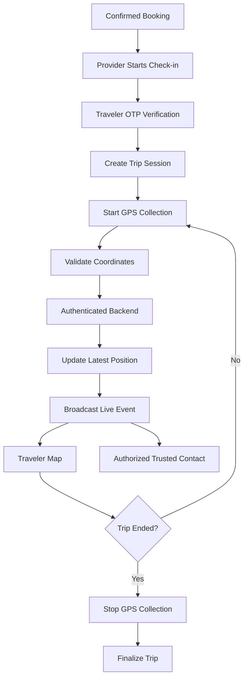
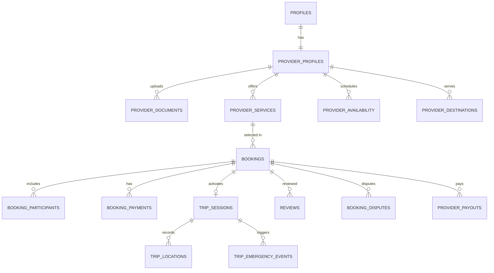

# Verified Local Guide & Boatman Marketplace: Architecture Design

**System:** ShopnoJatra Super-App Travel Ecosystem  
**Target Region:** Bangladesh (Cox's Bazar, Sundarbans, Bandarban, Sylhet, Sajek)  
**Standard:** Enterprise Zero-Trust, Geospatial & Role-Based Security

---

## 1. System Topology & Architectural Roles

The marketplace architecture connects three distinct actors across shared, hardened core services:

```
                      ┌──────────────────────────────────────┐
                      │          Supabase Auth & API         │
                      └──────────────────┬───────────────────┘
                                         │
        ┌────────────────────────────────┼────────────────────────────────┐
        ▼                                ▼                                ▼
  ┌───────────┐                   ┌───────────────┐                 ┌───────────┐
  │  Traveler │                   │  Local Expert │                 │   Admin   │
  │  (Client) │                   │  (Provider)   │                 │ (Console) │
  └─────┬─────┘                   └───────┬───────┘                 └─────┬─────┘
        │ Discovery & Booking             │ Onboarding & Execution        │ Moderation & Audit
        ▼                                 ▼                               ▼
  ┌─────────────────────────────────────────────────────────────────────────────┐
  │                 FastAPI Microservice Engine (v1/marketplace)                │
  │  - Atomic Reservation     - Provider Verification    - SOS & Dispute Ops    │
  │  - GPS Ingestion Bridge   - Pricing & Escrow Ledger  - GeoSearch Engine     │
  └──────────────────────────────────────┬──────────────────────────────────────┘
                                         ▼
  ┌─────────────────────────────────────────────────────────────────────────────┐
  │                 PostgreSQL 15+ Database with PostGIS & RLS                  │
  │  - provider_profiles      - provider_services        - bookings             │
  │  - trip_sessions          - trip_locations           - trip_emergency_events│
  └─────────────────────────────────────────────────────────────────────────────┘
```

### 1.1 Traveler Domain
- **Discovery Engine:** Geo-filtered provider exploration across Cox's Bazar, Sundarbans, Bandarban, Sylhet, Sajek.
- **Provider Categories:** Tour Guides, Local Guides, Boatmen, Trekking Guides, Nature Guides, Photographers, Adventure Operators.
- **Booking Flow:** Real-time availability query $\rightarrow$ Atomic slot hold $\rightarrow$ MFS/Card payment $\rightarrow$ Confirmation with 6-digit Trip OTP.
- **Trip Lifecycle:** In-app Leaflet/MapLibre live map, trusted contact live location sharing, and 1-tap SOS panic dispatch.

### 1.2 Local Expert (Provider) Domain
- **Onboarding & Verification:** NID/Passport upload, professional guide licenses, boat fitness/seaworthiness certificates, police clearance.
- **Service & Availability Engine:** Hourly, daily, or package-based pricing with capacity limits and blackout calendar management.
- **Operational Execution:** Review incoming booking requests, verify traveler via OTP check-in, trigger GPS collection, complete trips, view earnings ledger.

### 1.3 Admin Domain
- **Verification Portal:** Inspect submitted documents with signed, expiring URLs; approve, reject with reason, or suspend providers.
- **Operational Command Center:** Real-time monitor of authorized active trips, emergency SOS telemetry events, dispute handling, and payout reconciliations.

---

## 2. Live GPS & Trip Tracking Architecture (Image 1 Specification)



### 2.1 Sequence & Verification Rules
1. **Trip Check-In:** The provider initiates check-in when meeting the traveler.
2. **OTP Handshake:** The traveler provides a cryptographic 6-digit OTP generated upon booking confirmation. The provider enters this OTP to activate the `trip_sessions` record.
3. **GPS Collection:** Background / foreground geolocation begins collecting coordinates at 10–15s intervals.
4. **Coordinate Validation:** Coordinates outside Bangladesh geographical bounding box ($20.5^\circ\text{N} - 26.7^\circ\text{N}$, $88.0^\circ\text{E} - 92.7^\circ\text{E}$) or exhibiting implausible velocity (>130 km/h) are rejected.
5. **Realtime Broadcast:** The backend persists the location to `trip_locations` and broadcasts changes over Supabase Realtime / WebSocket to the traveler and designated emergency contacts.
6. **Trip Finalization:** The trip ends via mutual confirmation or emergency abort, immediately stopping GPS collection and archiving session data.

---

## 3. Relational Database Architecture (Image 2 Blueprint)



---

## 4. Security & Privacy Guarantees

1. **Zero Public Location Exposure:** `trip_locations` row-level security limits reads exclusively to:
   - The booking's traveler (`user_id = auth.uid()`).
   - The booking's provider (`provider_id = (SELECT id FROM provider_profiles WHERE user_id = auth.uid())`).
   - Trusted emergency contacts linked to the booking during an active emergency event.
   - Authorized platform admins (`role = 'admin'`).
2. **Document Protection:** Identity documents (NID, boat permits) are stored in private Supabase Storage buckets with maximum 15-minute presigned download URLs accessible only to admin reviewers.
3. **Double-Booking Prevention:** Atomic slot reservations using database locking and Postgres transaction isolation prevent double-booking of any provider on any given date/time slot.
