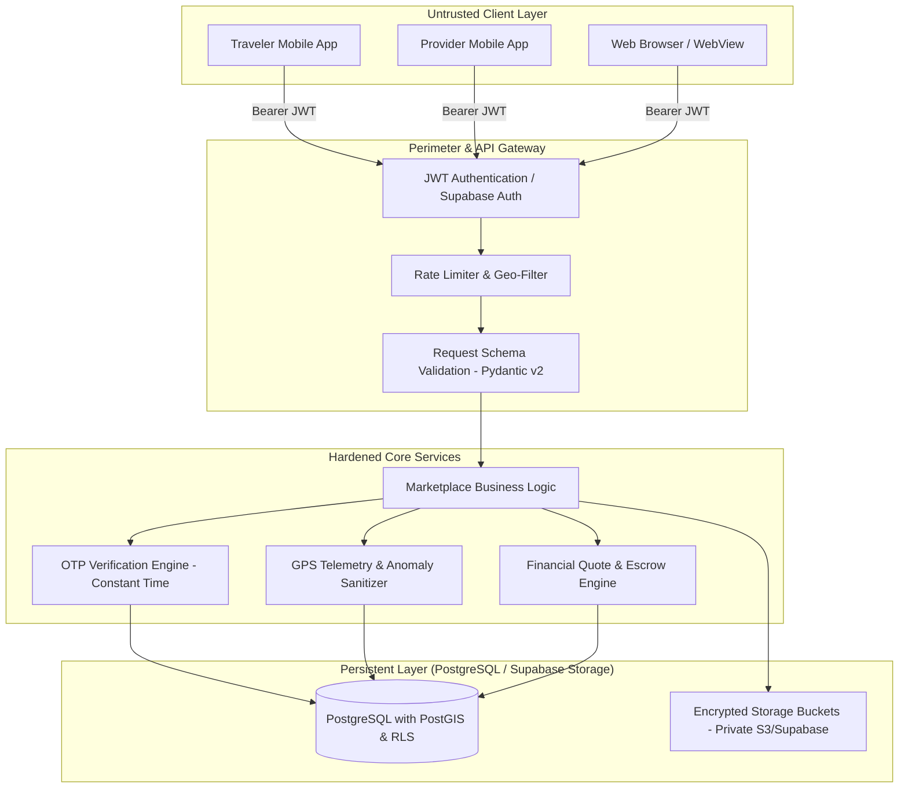

# Shopno Jatra - Verified Marketplace Security & Threat Model

**Version:** 1.0.0  
**Status:** Approved & Implemented  
**Classification:** Engineering & Security Standard  

---

## 1. Threat Model & Trust Boundaries

The Verified Local Guide & Boatman Marketplace operates under a zero-trust model between mobile client devices and the central backend infrastructure.



### Security Assertions
1. **Never trust client-submitted verification state**: Verification status (`draft`, `submitted`, `under_review`, `approved`, `rejected`, `suspended`) is mutable **only** by authenticated administrators via `/api/v1/marketplace/admin/*` endpoints or signed database triggers.
2. **Never trust client-submitted pricing or payment status**: Booking quote calculation, discounts, and payment confirmation are executed exclusively server-side.
3. **Never trust raw client GPS coordinates**: Ingested GPS points are validated against the geographic bounding box of Bangladesh ($20.3^\circ\text{N} - 26.8^\circ\text{N}$, $88.0^\circ\text{E} - 92.8^\circ\text{E}$), velocity caps ($120\text{ km/h}$ for land/speedboat, $30\text{ km/h}$ for country wooden boats), and sequential timestamp ordering.

---

## 2. Row-Level Security (RLS) Isolation Matrix

All tables in the marketplace schema enforce PostgreSQL Row-Level Security (`ALTER TABLE ... ENABLE ROW LEVEL SECURITY;`).

| Table Name | Operation | Permitted Roles | Condition / Security Rule |
| :--- | :--- | :--- | :--- |
| `provider_profiles` | `SELECT` | Public / Anon | `verification_status = 'approved' AND is_active = true` |
| `provider_profiles` | `SELECT` | Provider Owner | `user_id = auth.uid()` |
| `provider_profiles` | `ALL` | Admin | `auth.is_admin() = true` |
| `provider_documents` | `SELECT` / `INSERT` | Provider Owner | `provider_id IN (SELECT id FROM provider_profiles WHERE user_id = auth.uid())` |
| `provider_documents` | `ALL` | Admin | `auth.is_admin() = true` (Public has **0 access**) |
| `provider_services` | `SELECT` | Public / Anon | `status = 'published'` and provider is approved |
| `provider_services` | `ALL` | Provider Owner | Provider matches `auth.uid()` |
| `marketplace_bookings` | `SELECT` | Traveler / Provider | `traveler_id = auth.uid() OR provider_id IN (SELECT id FROM provider_profiles WHERE user_id = auth.uid())` |
| `trip_sessions` | `SELECT` / `UPDATE` | Session Participants | Traveler or Provider of the active booking |
| `trip_locations` | `INSERT` | Active Provider | Ingested by assigned provider during active trip state |
| `trip_locations` | `SELECT` | Authorized Parties | Session traveler, assigned provider, admin, or verified trusted contact token |
| `trip_emergency_events` | `ALL` | Admin / Participants | Immediate alert logging, immutable audit records |
| `marketplace_payouts` | `SELECT` | Provider Owner | Only view own payouts; creation restricted to system cron / admin |

---

## 3. Trip Handshake & Check-in Cryptography (Image 1 Compliance)

To prevent phantom trips, fraudulent billing, or unverified provider check-ins, the live tracking workflow requires an explicit OTP handshake:

1. **OTP Generation**:
   - When a booking is confirmed, backend generates a cryptographically secure 6-digit random token using system entropy:
   ```python
   import secrets
   otp_code = f"{secrets.randbelow(1_000_000):06d}"
   ```
2. **Traveler Custody**:
   - The OTP is revealed **only** to the traveler via the mobile app UI.
3. **Physical Provider Handshake**:
   - Upon meeting the traveler in person (at destination dock, jetty, or trail basecamp), the provider asks for the 6-digit code.
4. **Constant-Time Verification**:
   - The backend verifies the submitted code using constant-time string comparison to prevent timing side-channel attacks:
   ```python
   if not secrets.compare_digest(stored_otp, submitted_otp):
       raise HTTPException(status_code=400, detail="Invalid OTP code")
   ```
5. **Session Activation**:
   - Only upon matching does the `trip_sessions` record transition to `active` status with `started_at = clock_timestamp()`.

---

## 4. GPS Telemetry Verification & Anti-Spoofing

GPS coordinate ingestion through `POST /api/v1/marketplace/trips/{trip_id}/locations` passes through rigorous validation before being stored or broadcast:

```python
# Bangladesh Bounding Box Boundaries
BD_LAT_MIN, BD_LAT_MAX = 20.3, 26.8
BD_LNG_MIN, BD_LNG_MAX = 88.0, 92.8

def validate_telemetry(lat: float, lng: float, prev_point, timestamp):
    # 1. Geographic Range Check
    if not (BD_LAT_MIN <= lat <= BD_LAT_MAX and BD_LNG_MIN <= lng <= BD_LNG_MAX):
        raise InvalidCoordinatesError("Coordinates fall outside Bangladesh boundaries")

    # 2. Maximum Plausible Speed Check (Haversine distance / delta_t)
    if prev_point:
        delta_seconds = (timestamp - prev_point.timestamp).total_seconds()
        if delta_seconds > 0:
            distance_km = haversine_distance(prev_point.lat, prev_point.lng, lat, lng)
            speed_kmh = (distance_km / delta_seconds) * 3600
            if speed_kmh > 150.0:  # Physical limit for local transport
                raise AnomalyDetectedError("Velocity exceeds maximum plausible speed")
```

---

## 5. PII Redaction & Storage Bucket Architecture

### Private Bucket Architecture
Provider identity documents (Smart NID card, BIWTA boat registration, Police Clearance, Tour Guide license) are uploaded to a private Supabase bucket:
- **Bucket**: `provider-documents` (Public Access: **DISABLED**)
- **Presigned URLs**: Access URLs are generated with short expiration limits:
  - Admin inspection view: **15 minutes** TTL.
  - Provider upload slot: **5 minutes** single-use PUT URL.

### Data at Rest Encryption
- Database fields containing sensitive contact data or National ID numbers are encrypted or hashed where direct search is required.
- Emergency trusted contact telephone numbers are accessible only during an active trip session and redacted from general profile views.

---

## 6. Financial Concurrency & Double-Booking Prevention

1. **Pessimistic Locking**:
   - During quote reservation and booking creation, the target service slot is locked using PostgreSQL pessimistic row locking:
   ```sql
   SELECT * FROM provider_availability 
   WHERE provider_id = :provider_id AND date = :date 
   FOR UPDATE;
   ```
2. **Database Exclusion Constraints**:
   - Time-range overlap prevention for specific boat/guide assignments:
   ```sql
   ALTER TABLE marketplace_bookings
   ADD CONSTRAINT no_overlapping_provider_bookings
   EXCLUDE USING gist (
       provider_id WITH =,
       booking_period WITH &&
   ) WHERE (status IN ('confirmed', 'active'));
   ```
3. **Escrow Hold & Dispute Window**:
   - Payouts are not released immediately upon trip completion.
   - A mandatory 48-hour dispute window is enforced. If no dispute or emergency event is raised, the booking transitions to `payout_eligible`.
